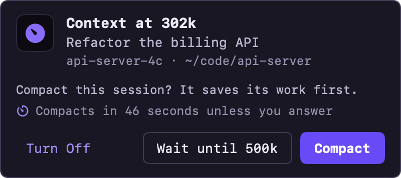
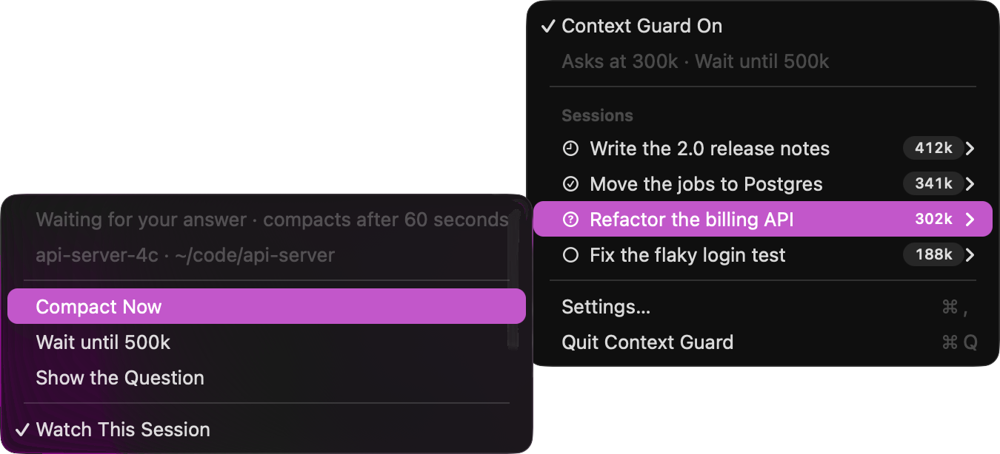
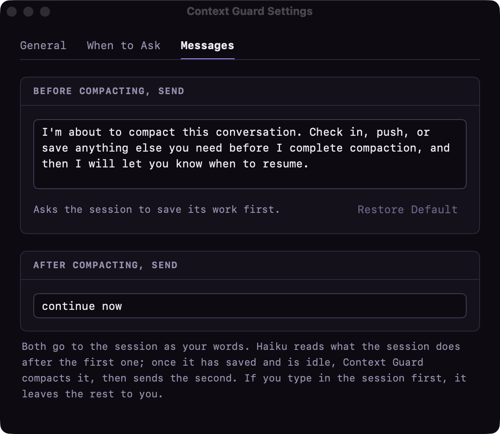

Let me get this out of the way first: there are about a thousand tools like this. You can run `/compact` yourself whenever you feel like it, let auto-compact do its thing, or pick from a pile of apps, scripts and hooks other people have shared. They all work, and there are plenty of other techniques too. This is just the one I like, I had a nice time making it, and I thought it was a fun little thing to share with the community.

## The Itch

I don't let sessions run forever. The problem is attention. When I'm personally managing a few Claude Code sessions at once, I'm not watching every one of them, and one fills up while I'm looking at another. Compaction kicks in mid-task, and the session comes back with a summary and has to work out where it was. Sometimes that's fine. Sometimes it forgot the one thing that mattered.

What I wanted was simple: ask me first. If I say yes, or I'm busy and don't answer, let the session wrap up (commit, push, write down where it is) before it gets compacted. Then tell it to keep going.

It also gives me decent automation for the sessions I'm driving by hand, without reaching for any of my bigger multi-bot loop infrastructure. Sometimes you just want a small tool that does one job.

## What It Does

Context Guard lives in the macOS menu bar. When a session reaches 300k tokens of context, a popup asks whether to compact it:

{: w="400" h="178" }

- **Compact** asks the session to save its work first. Once it's done, the session is compacted and gets a "continue now" so it picks up where it left off.
- **Wait until 500k** lets it keep going and does the same thing later.
- **No answer in 60 seconds** counts as Compact, so walking away doesn't leave the session hanging.

How does it know the session has finished saving? Every 10 seconds while the session is idle, Haiku reads what it did after the save message and decides. If the session asked you a question or is still waiting on CI, it holds off. There's no API key or sign-in: it asks Haiku through the Claude Code session it's running in.

Every session also gets its own menu, with **Compact Now** for when you want it done right away, and a switch to stop watching that one session:

{: w="675" h="307" }

A notice tells you how it went, like the green one at the top of this post. And Settings lets you change the thresholds and both messages:

{: w="600" h="521" }

It doesn't care which terminal you use. I live in Warp, but I tried it in Terminal and Ghostty too. Everything goes through Claude Code's own hooks and plugins.

## Try It

You'll need macOS 14 or newer, the Xcode Command Line Tools and Claude Code. Then:

```bash
git clone https://github.com/SpaceTerran/context-guard.git
cd context-guard
./install.sh
```

It builds on your Mac in about a minute, adds its hooks to Claude Code (backing up your settings first) and puts the app in `~/Applications`. `./install.sh --uninstall` takes it all back out.

> **Tip:** The save message is just text. Change it in Settings › Messages to whatever "wrap up" means for you.
{: .prompt-tip }

## Wrapping Up

That's it. Small app, one job. If you've got your own way of handling long sessions, I'd love to hear it, so drop a comment below. And if you want to bend this one to your own workflow, it's all yours: [github.com/SpaceTerran/context-guard](https://github.com/SpaceTerran/context-guard)

<br><br>

<small>
**Note:** Claude, Claude Code and Haiku are trademarks of Anthropic. macOS is a trademark of Apple Inc. This project is not affiliated with or endorsed by either company.
</small>
