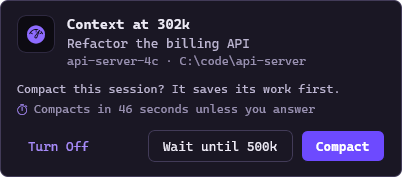
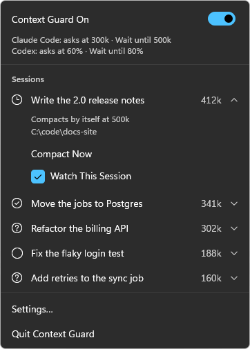
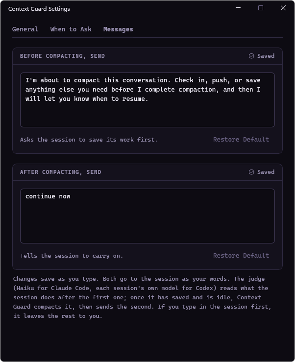

A week ago I shared [Context Guard](/posts/context-guard-claude-code/), a small Mac menu bar app that asks before a long Claude Code session gets compacted, lets the session save its work first, then tells it to carry on. Since then I've been asked for a Windows version, so here it is.

Everything in the first post works the same way on Windows: the same choices, the same messages, the same settings. This post just covers what's different. And since that first post, Context Guard also looks after Codex CLI sessions, on both Mac and Windows.

> **Terminal only:** Context Guard guards Claude Code and Codex CLI sessions running in a terminal. It doesn't work with the Claude or Codex desktop apps, and it leaves them alone.
{: .prompt-info }

## What It Looks Like on Windows

On Windows, Context Guard lives in the notification area. When a session reaches 300k tokens of context, a popup shows up at the bottom right, above the taskbar:

{: w="402" h="177" }

The choices are the ones from the Mac: **Compact** has the session save its work first, **Wait until 500k** asks again later, and no answer in 60 seconds counts as Compact. The popups never take the focus, so if one shows up while you're typing in a terminal, or you click one of its buttons, your typing keeps going to the terminal.

Clicking the icon opens the same menu as on the Mac, with every session, **Compact Now**, and a switch to stop watching one:

{: w="362" h="506" }

And Settings has the same tabs and the same messages:

{: w="602" h="739" }

It doesn't care which terminal you use. I tried it in Windows Terminal and in the classic console window.

## Try It

You'll need Windows 11 on x64 and Claude Code 2.1.287 or newer (and Codex CLI 0.154 or newer for Codex sessions). Then, in PowerShell:

```powershell
cd ~\Downloads
curl.exe -LO https://github.com/SpaceTerran/context-guard/releases/latest/download/context-guard-windows-x64.zip
Get-FileHash context-guard-windows-x64.zip   # the same as in the release's .sha256 file
Expand-Archive context-guard-windows-x64.zip -Force
powershell -ExecutionPolicy Bypass -File context-guard-windows-x64\context-guard\install.ps1
```

It needs no admin rights. It adds its hooks to Claude Code (backing up your settings first) and installs the app with a Start menu shortcut. Running a newer release the same way updates it, and `-Uninstall` (or Uninstall in Settings › Apps) takes it all back out.

> **Heads-up:** Context Guard isn't code-signed yet, so Smart App Control blocks it on PCs where that's turned on.
{: .prompt-warning }

On the Mac nothing changed: `git clone` and `./install.sh`, as in the first post.

## Under the Hood

The Mac version is all Swift, and its SwiftUI app doesn't run on Windows. So I split it: everything that decides what to do and what to say lives in one shared Swift core that runs on both, and each platform gets a thin app that only draws it. On the Mac that's the same SwiftUI app as before. On Windows it's a native WinUI 3 app. Both are tested on every change, so the two versions stay the same.

## Good to Know

- **Terminal sessions only,** on Windows and on the Mac. The Claude and Codex desktop apps aren't guarded.
- Windows 11 on x64 only, for now.
- Codex sessions in a terminal run as administrator aren't guarded, because Codex runs those apart from its other sessions.

## Wrapping Up

Same small app, one job, now on both platforms. If you try it on Windows, let me know how it goes in the comments, especially in terminals I haven't tried. It's all here: [github.com/SpaceTerran/context-guard](https://github.com/SpaceTerran/context-guard)

<br><br>

<small>
**Note:** Claude and Claude Code are trademarks of Anthropic. Codex is a trademark of OpenAI. Windows, PowerShell and WinUI are trademarks of Microsoft. macOS is a trademark of Apple Inc. This project is not affiliated with or endorsed by any of these companies.
</small>
