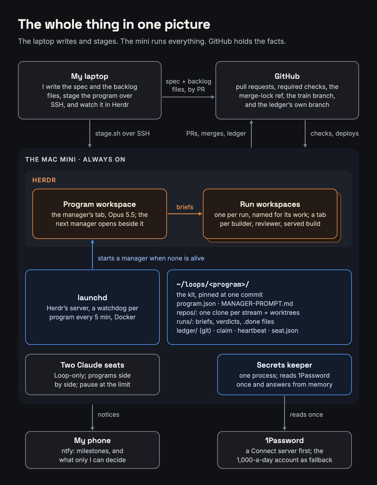
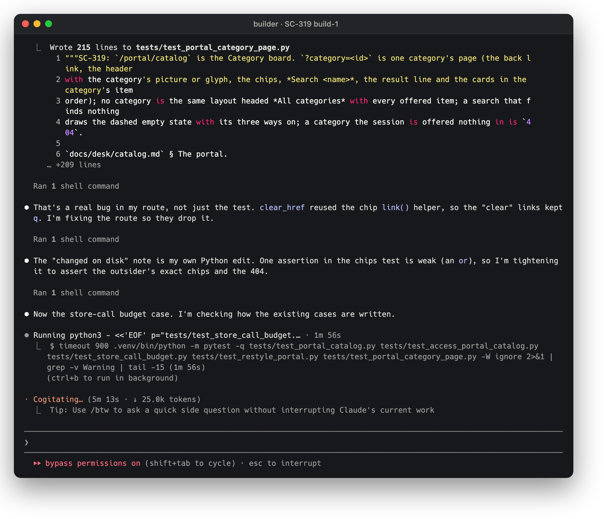
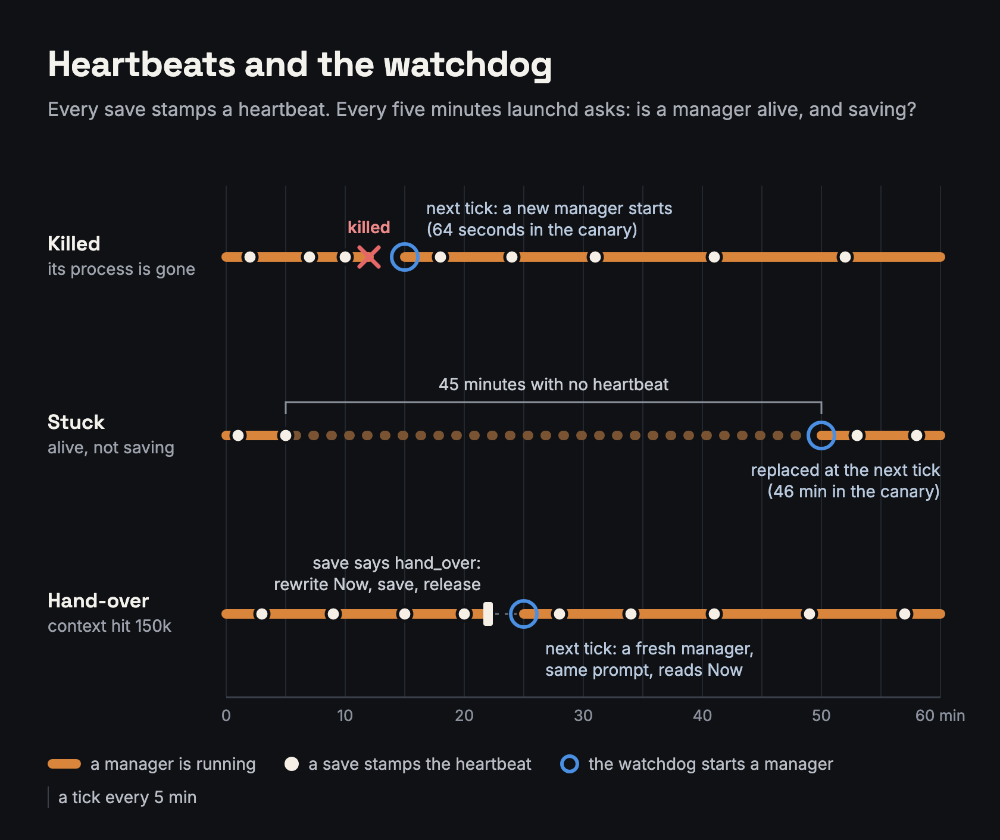
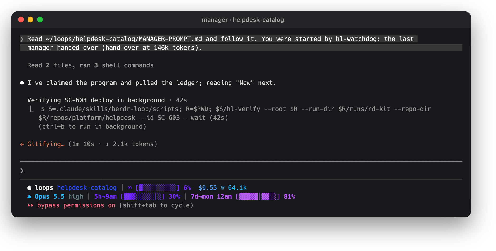
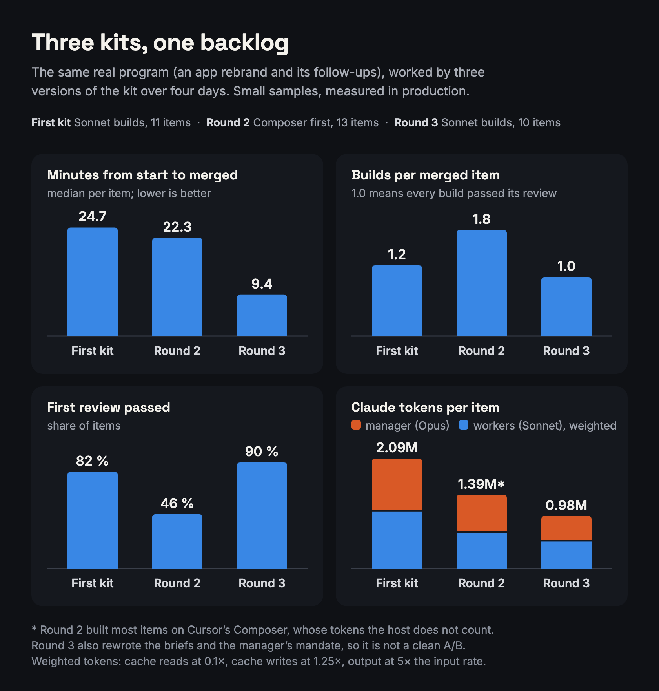
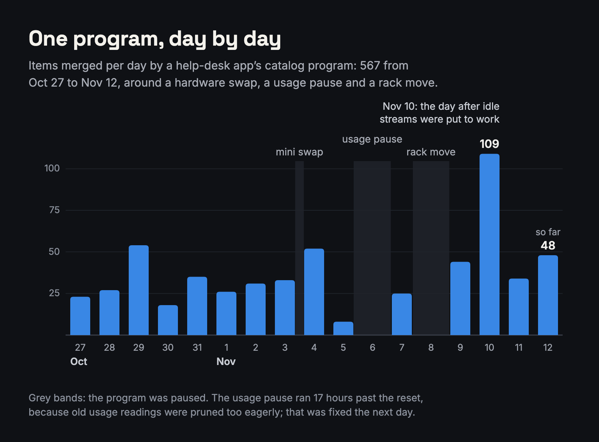

For the last month, most of the code in my repos has been written by sessions I never typed into. One Claude Opus session, the manager, sits in a terminal tab on a Mac that's always on. It works through a backlog by starting ordinary Claude Code and Cursor sessions in other tabs, handing each one a written brief, and acting on the file it writes back. Builders build, a fresh session reviews, and a script merges.

Between October 12 and November 12 that setup merged **1,351 items** across nine programs, including one that's still running and has merged 567 by itself. I call it the Herdr loop, after [Herdr](https://herdr.dev/), the terminal multiplexer it runs in.

This post is the long version: what runs where, what each piece is for, why some things are scripts and others are prompts, how the manager survives crashes and its own context filling up, and where the tokens go. All the numbers are measured, and I've kept the failures in, because most of the design came from them.

> **Note:** This is about a system I built for my own repos, on my own hardware. I've renamed my projects and left out accounts and addresses. Everything else is as it ran.
{: .prompt-info }

> **Tip:** This is the latest of several loop systems I've built. The shell loops and LoopRunner below were earlier ones. Models and tools keep getting better, and as soon as a version is stable I push the envelope again, so expect parts of this post to be out of date by the time you read it. Read it as a snapshot, not a finished design. And don't let that stop you: start with what works today, and iterate. More on that at the end.
{: .prompt-tip }

## Why I Stopped Babysitting Sessions

It started the way it probably starts for everyone. I'd have three or four Claude Code sessions open, each on a different task, and I'd bounce between them answering questions, pasting errors and saying "yes, keep going". That works until you have a backlog of 140 items and a day job.

Next came shell loops: `claude -p` in a `while` loop, reading a status file, doing one item, writing the status back. Then **LoopRunner**, a proper Python service in a container. Every phase ran as a headless `claude -p` behind a wrapper that parsed the stream, scrubbed the environment, injected a token and killed anything that went silent or ran too long. It worked: 204 of 217 items merged in its last week.

But it had a problem I couldn't engineer around. **Nothing can talk to a headless agent.** If a session got confused, or blocked on something small, the only outcomes were "blocked" and "failed", and both were final. Of the 22 recipes on record for when things went wrong, most were babysitting the runner: editing state files by hand, reopening PRs, re-running reviews, restarting loops after a container restart.

So I flipped it around. Instead of a service driving headless processes, a **model** drives **interactive sessions** that anyone can look at. The manager types a one-line prompt into a pane, reads the file the worker writes back, and if something's off it can just ask the worker a follow-up question. The protocol stayed (briefs, verdicts, a gated merge, a deploy check). The wrapper, the container and LoopRunner's GUI went.

To be clear, I don't want interactive sessions for their own sake. What I needed was a way to talk to an agent that's already running, and today an interactive session is the most practical way I've found to do that. As the tools get better at steering a running agent, I expect a lot of the pane machinery below to go away.

I built the first version on October 11. It ran a canary that night (10 items on a scratch repo, plus 9 deliberate fault exercises like killing the manager mid-item), and started its first real program the next morning. LoopRunner was shut down four days later.

## The Whole Thing in One Picture

{: w="840" h="1080" }
_Amber means a model decides, blue means a script runs it, grey is something outside._

Three places matter:

- **My laptop** is where I write. Every program starts as a spec file and some backlog files, which I review like any other PR. A script stages the program onto the mini over SSH, and I can attach to Herdr remotely to watch.
- **The Mac mini** runs everything. Herdr's server, a watchdog per program, Docker for the tests, the manager, and every worker: Claude Code sessions, plus Cursor's command-line agent for some builds. For sizing: a Claude worker is about 270 MB at start, a Cursor worker 570 MB, and a reviewer's browser 630 MB across nine processes.
- **GitHub** holds the facts: pull requests, required checks, deploy runs, a merge lock, and the program's ledger on its own branch.

Why a Mac mini and not a Linux server? I work on a Mac and like it, so the loop grew up on one. Linux would very likely work fine, with a systemd timer in place of launchd.

The one Mac quirk that matters: Claude Code and Cursor keep their sign-ins in the macOS Keychain, and the Keychain is locked over SSH. Neither tool can sign in from an SSH shell, but both work fine inside a Herdr pane on the machine itself. The mini also holds the loop's own Claude sign-in. Mine stays on my laptop, and no program ever runs on it.

## A Few Words First

The rest of the post uses these words:

- **Herdr**: a terminal multiplexer for coding agents. Like tmux, it has workspaces, tabs and panes, and its command line can start an agent in a pane, type a prompt into it, read its screen, and say whether it looks idle, working, blocked or done. Those readings are hints, as you'll see.
- **Kit**: the scripts (all named `hl-…`), the manager prompt and the brief templates. Each program gets its own copy.
- **Worker**: any session the manager starts, such as a builder, a reviewer, a premise check or a correction. Most are Claude Code sessions. Some builds go to Cursor's command-line agent instead, which runs Cursor's own model, Composer.
- **Program**: one body of work, with a spec, some backlog files, one manager and one ledger.
- **Backlog file**: a markdown file of items (`*-ITEMS.md`), each with a scope, an Accept list and a Verify line.
- **Item**: one change, which becomes one pull request.
- **Premise check**: an independent check, before anything is built, that the item's criteria hold against the code.
- **Run**: one backlog file being worked, in its own Herdr workspace.
- **Stream**: a lane of work with its own clone of the repo, so two runs never share a checkout.
- **Train**: an opt-in mode for a repo, where items merge into an integration branch on their review alone, and CI runs once per batch (five items by default) before the batch is promoted to the base branch.
- **Brief**: the file a worker is told to read. It says what to do and what to write back.
- **Done file**: an empty `<phase>-<n>.done` the worker touches last. It's the only "finished" signal anyone trusts.
- **Verdict**: the reviewer's JSON, with pass or fail per criterion and a fix list.
- **Ledger**: the program's record in git. Its "Now" section says where things stand.
- **Seat**: a Claude sign-in with its own usage windows.

## One Item's Life

{: w="840" h="1720" }
_Every step sits in the lane of whoever does it. Between any two model steps, a script checks the hand-off._

Here's one item, start to finish:

1. **Route.** The manager reads the item and picks the builder, the effort, whether it needs an independent premise check first, and whether the reviewer must look at it in a browser.
2. **Prepare** (`hl-flow prepare`). A script makes the worktree and branch from fresh `main`, installs the item's Accept list as the contract, works out a port, and runs the repo's setup.
3. **Build.** A builder session gets its brief, plans, writes the code and tests, opens the PR with the contract in the body, writes a short report, and touches its done file.
4. **Built** (`hl-flow built`). A script checks the PR: it exists, isn't a draft, isn't set to merge itself, has the contract in its body, and the worktree is clean at the PR's head. A fault goes straight back to the still-open builder, which costs one message instead of a whole review.
5. **Review.** A script serves the build on its port, and a *fresh* Claude session reviews it. It never reuses the builder's session, and a script refuses if you try. The reviewer runs things, opens pages, takes screenshots, and writes a verdict.
6. **Reviewed** (`hl-flow reviewed`). A script validates the verdict, reads the reviewer's transcript for proof it actually exercised the change, posts the verdict on the PR, and stops the served build.
7. **Decide.** PASS goes to merge. FAIL goes back to a builder with the fix list. If the builder thinks a criterion is wrong, a separate correction session rules on it; the manager never edits a criterion itself.
8. **Merge** (`hl-merge`). The only way anything merges. More on it below.
9. **Verify** (`hl-verify`). After the deploy, a script runs the item's own Verify command, on a deadline.
10. **Close and save.** The worktree goes, the ledger is written and pushed, and the heartbeat is stamped.

Here's what an item looks like in a backlog file. This one is real, trimmed a little:

```markdown
## PTR-21 — `terraform validate` prints no deprecation warning for the user table's index

**Scope.** `infra/dynamodb.tf` declares the user table with one global secondary
index whose keys are given as `hash_key`/`range_key`, which the AWS provider now
deprecates. What it becomes: two `key_schema` blocks. **The live table must not
change:** a replace, a destroy, or any change to the index is a stop.
Paths: `infra/dynamodb.tf` only.

**Accept.**
1. `terraform -chdir=infra validate -no-color 2>&1 | grep -c 'is deprecated'` prints `0`
   (it prints `2` at `021acaa`), and `validate` reports the configuration valid.
2. `grep -c 'key_schema' infra/dynamodb.tf` prints `2` (it prints `0` at `021acaa`).
3. `terraform -chdir=infra fmt -check -recursive` exits 0.
4. The pull request's Terraform plan shows the table with no change.

**Depends.** none.
**Floor.** sonnet: it rewrites the declaration of a live table; a wrong block could plan a replace.
**Verify.** `<poll the apply workflow for this merge's SHA, then curl the service's health check>`
Wait. 30
```

A few rules make that format work:

- **Accept lines describe behavior**, each with a value and what it was before the change, so a reviewer can tell a real fix from a coincidence.
- **There's never a "the test suite passes" line.** CI runs the suites once, and a suite written into a criterion gets run again by the builder and again by the reviewer. In the first program that was 4 to 12 long test runs for one item.
- **`Floor.`** is the least an item may be routed with: `sonnet` rules out a Composer build, `premise` requires a premise check, and `look` requires a review in a browser. A script refuses any route below it.
- **`Wait.`** is a deadline, not a soak: the Verify runs right away, then every minute until the deadline.

### Which Model Does What

Workers come from two tools: Claude Code, running Claude models, and Cursor's command-line agent, running Cursor's Composer. Cursor is there for cost: it's a cheaper builder, and its tokens don't count against Claude's usage windows. Here's who gets what:

- **The manager** is Claude Opus 5.5 at high effort. It's the only Opus session in a program.
- **Builders** are Claude Sonnet 5.5 for anything that changes behavior or what a person sees, spans many files, leaves a design choice open, or touches sign-in, money or infrastructure.
- **Cursor's Composer 2.5** builds only clearly mechanical items: a constant, a rename, a version bump, a string given word for word, a deletion. A Composer build that fails one review is rebuilt on Sonnet.
- **Every reviewer, premise check and correction** is a Claude session. A script refuses a Cursor reviewer outright.
- **Effort** is `high` by default. `low` is excluded because at low effort Sonnet can report a change done without running a check. `max` is excluded for cost.

That routing came from measuring, not from taste. More on that in the numbers.

## A Script May Refuse; It May Not Decide

This is the one rule the whole kit hangs on, and it's written into the kit's own rules for anyone changing it:

> A script may refuse; it may not decide. If a change puts judgement into code, it belongs in the prompt as guidance instead.

Judgment is cheap in a prompt and expensive in code. Code that tries to decide which engine should build an item, or what a failing review means, turns into a pile of special cases. A model handles that well. But a model will also, now and then, skip a step, misread an exit code, or talk itself into something. So the things that **must not slip** live in scripts, and the scripts only ever say no.

Here's how that splits. Each row is a decision the loop makes or a guarantee it keeps, with who's responsible for it:

- **Prompt**: a model decides, guided by its prompt or brief. Nothing checks the call.
- **Script**: a script checks it every time and refuses to go on when the check fails. No model can talk its way past it.
- **Both**: the manager decides, inside a limit a script enforces.

| Decision or guarantee | Who's responsible |
|---|---|
| Which engine builds an item | Both: prompt picks, script enforces the floor |
| Moving a failed Composer build to Sonnet | Prompt only; no script checks it |
| Model names | Script: read from `program.json`, never typed |
| How many builds and reviews an item gets | Script: limits counted on disk |
| What to do when an item hits a limit | Prompt |
| The reviewer isn't the builder | Script: it compares session ids |
| Merging | Script: `hl-merge`, the only path |
| What a FAIL means | Prompt: rework, a correction, or park |
| Did the reviewer run the change? | Script: it reads the transcript |
| Was the review thorough? | Prompt: the reviewer's call; no script can tell |
| Checking the deploy | Script: runs the item's own Verify line |
| What to do about a red deploy | Prompt: a fix-forward item |
| Slow CI, idle streams, waits | Both: script reports, prompt acts |

`hl-merge` is the clearest example. It refuses unless every one of these holds:

- the latest review validates as PASS;
- the reviewer's transcript shows it called the served build (and, if the item needed a look, opened a page in the browser and took a screenshot);
- the checkout didn't change during the review;
- the contract is the one that was graded, and the PR head is the graded commit (or the same patch);
- the reviewer wasn't the builder, and auto-merge isn't armed;
- the item is within its limits on builds and reviews, and no protected path is touched;
- every required check is green, and GitHub doesn't say BLOCKED;
- no earlier merge in the run is still waiting on its Verify.

Then it takes a lock: a git ref in the target repo (`refs/looprunner/merge-lock`, the same one LoopRunner used, so the two could never merge over each other). Holding it, `hl-merge` squash-merges the exact graded commit, waits until GitHub says MERGED, and releases the lock.

Three examples of why these are scripts:

- **What merges is what was graded.** A reviewer grades whatever is in its checkout, and from inside it can't tell whether that's the commit. In a test run, a build's own start-up command copied a working file over a broken one that was in the commit. The reviewer saw a working build and passed it, and that pass would have merged the broken commit. Now `hl-flow review` refuses to start a review on a checkout whose tracked files differ from the commit, before anything is served, and the build goes back with a note.
- **Whitespace counts.** A commit pushed after a review once got merged even though it differed from the reviewed one, because the two patches were compared with whitespace left out, and whitespace was the only difference. In Python an indentation *is* the change, so now they're compared exactly (`git patch-id --verbatim`).
- **Verify.** The deploy check used to be a line the manager would turn into a command. Once it built that command from the wrong field, ran an empty script, and read its exit 0 as a pass. Now `hl-verify` reads the item's own line and runs it as written.

### Getting a Session Running

A big chunk of the code has nothing to do with judgment. It's the plumbing that gets a session running in a pane in a known state, and it took longer to get right than anything else:

- **Every worker starts bare.** `--setting-sources project,local`, `--strict-mcp-config`, a fixed `--tools` list, and auto-memory off. No hooks, plugins, skills or memory from my own setup leak in, so a builder's context can't follow it into a reviewer. The reviewer gets exactly one MCP server: its own private browser.
- **Permission prompts are off.** Nobody is there to answer them, so every session runs with Claude Code's permission checks bypassed (you can see it in the screenshots below). That costs isolation: a worker runs as the Mac's user, beside everything else on it. What keeps it in check is the loop's own GitHub token, which isn't an admin's, and the merge gate.
- **The prompt is one line.** `hl-spawn` renders the brief to a file and types `Read <brief> and do exactly what it says.`, capped at 500 characters. Herdr delivers anything longer than roughly 600 characters as pasted content, and Claude is told that pasted content may hold instructions its user didn't write. That's exactly right for a paste, and exactly wrong for a brief.
- **The folder-trust race.** Claude asks whether you trust a new folder, and the default answer is "No, exit". Herdr reports the agent as ready the moment the dialog is answered, while Claude is still starting, and text typed then gets lost. Sending right away lost 4 of 6 first prompts. Now `hl-spawn` answers only that dialog, waits until the screen shows the real input box, sends with `--wait --until working`, checks the transcript to see that the prompt arrived, and retries up to three times. That got 6 of 6.
- **Secrets never touch a command line.** A worker pane sources a small env script that asks the secrets keeper (more on it in the 1Password section) for its tokens inside the pane. `hl-spawn` then checks that the agent process actually has them.
- **Which sign-in.** Claude Code uses the sign-in in whatever config directory `CLAUDE_CONFIG_DIR` names, so `hl-spawn` sets it for every Claude worker and refuses to start one without it. No session lands on my own sign-in by accident.
- **Leftover processes.** Closing a pane kills the agent, but not a job it backgrounded. On macOS that job gets adopted by launchd and hides from the usual ways of finding it. A builder once left four CPU loops running for nine and a half hours. Now `hl-spawn` points each pane's `ZDOTDIR` at a tiny `.zshenv` that records every shell's pid and start time, and closing the attempt kills exactly those shells' sessions.
- **A sub-agent guard.** A `PreToolUse` hook rewrites every sub-agent call a worker makes so it runs in the foreground, on the worker's own model, in the worker's own checkout. It isn't proven: on the mini a sub-agent once ran in the background anyway, so worker sub-agents stay off unless a program turns them on.

## The Prompts

There are two kinds: one long prompt for the manager, and a short brief for each worker phase.

### The Manager Prompt

The manager prompt is **9,680 words**, about **13.9k tokens**. The first version was 4,915 words, so it roughly doubled in a month. I'll come back to that, because it sits awkwardly next to the prompt's own "keep your context small" rule.

It opens like this:

> You are the manager of a backlog run for {{PROGRAM}}. You run in one tab of a Herdr workspace on the Mac mini. You get the work done by starting ordinary Claude Code and Cursor sessions in other workspaces, giving each a written brief, and acting on the file it writes back. Earlier manager sessions have come and gone, and workers may be mid-task right now with nobody watching. Find out where things stand, then carry the program forward until every backlog file below is complete and every gate is closed.

The most important design choice is in the header: **the prompt holds no state.** It's the same file for every manager of a program, from the first to the 282nd. Where things stand lives in the ledger's "Now" section, which every manager rewrites before it stops. That's what makes a manager disposable, and disposable managers are what make everything else in this post work.

The rest is in sections, roughly in the order a manager needs them:

- **The mandate.** Build, review, merge on a pass, confirm the deploy. "You route, arbitrate and record. You do not build, you do not review, and you never write or edit a criterion. Builders build, reviewers judge, one script merges."
- **Where the truth is.** Run directories first, then GitHub, then Herdr, then the ledger. "A status written anywhere is a claim; the pull request and the run are the fact." And about Herdr: "Its `idle` and `done` prove nothing; a done file does."
- **Start of every session.** Eight steps: check it's inside Herdr, claim the program, read "Now", release any merge lock a dead session left, reconcile the runs against Herdr and GitHub, check capacity and usage, check the secrets budget, then save, start its background waits, and report.
- **One item**, step by step, including how to read every answer each script gives.
- **The working sections**: routing, workers and waiting, CI time, trains, pull requests from outside the program, what to do when a stream has nothing to run, and keeping the ledger short.
- **Rules that are not negotiable.** Only `hl-merge` merges. Never edit a criterion or a verdict. Kill one PID at a time, never by name. Record a defect you notice; don't fix it in passing. "Never say verified unless a script or you ran the check."
- **Save, and hand over.**

Three parts of the mandate are worth calling out, because each one came from watching a manager do something reasonable and wrong.

**It may ask me only five things.** Money or account policy, deleting data or a feature, access no credential gives, a choice between two product directions where neither is clearly right, and a step that needs me personally (my phone, my second factor, a dashboard with no API). Everything else it decides, records as "decided by the manager", and keeps going. It asks once, parks only that item, and carries on with the rest. "Never end a turn on a question while work remains."

**Every gate is the manager's, whoever the text names.** Backlogs sometimes say "the operator confirms X". Early on, the help-desk feature push shipped everything it could build and then idled on 30-minute timers for ten hours, waiting on a laptop session that was never coming. Now a check a person would do is a check a reviewer does in a browser, with screenshots kept.

**Nothing waits to see whether it fixes itself.** Backlogs are full of clocks like "after 24 hours", "once it soaks" or "if the queue doesn't drain in a day". The manager rewrites each one as the check it stands for, and runs that check now. On the catalog program, every stream once stood idle for four hours behind one item meant to be built "if the queue does not drain in a day". The only waits that survive are the ones that protect people: someone who could be locked out, or data that can't be restored.

### The Briefs

Each worker phase has its own brief template: a premise check, a contract draft (criteria for an item that came without them), a build, a review, a delta confirm (a cheaper re-check of a fix list), a blind grade (the original review style, which may not read the diff), and a correction. A script fills each one from the item, the program and the repo's facts, and refuses if anything is missing. Every brief ends the same way: write your result file, touch your done file, end your turn.

| Brief | Writes back | Ends with |
|---|---|---|
| Premise check | notes per criterion | `AGREED` or `REVISE` |
| Build | a PR and a short report | how to serve the build |
| Review | `verdict-<n>.json` | `PASS`, `FAIL` or `INCONCLUSIVE` |
| Confirm | an answer per fix-list entry | the same three |
| Correction | a ruling on one criterion | `STANDS` or `CORRECTED` |

Builds go to Sonnet or Composer. Everything else is a fresh Claude session.

When I rewrote the first set, I wanted them "less rigid, more freedom for the worker, the same quality". I assumed that meant shorter. It didn't:

{: w="840" h="760" }
_Most briefs got longer. What shrank was the list of prohibitions._

The build brief went from 26 uses of "do not" and "never" to 7, and from 12 prohibition bullets to 1, and it got 22% longer. The kit's own notes explain it:

> The first set told a worker how, in twelve "do not" lines for a builder and eleven for an evaluator. Two of the evaluator's were read as forbidding the suite a criterion asked for, and cost three grades in the first real program. This set says what is wanted and why, and leaves the how.

That turned out to be one of the biggest lessons of the whole project: these models need context and a clear goal, not step-by-step instructions. I come back to it at the end.

What I do now: **a rule comes out of a brief only when a script enforces it**, and the briefs' README names that script. A rule I took out with no script behind it is listed there as unproven. A few before-and-after pairs:

**Waiting.** The old "bounded" example wasn't bounded.

> v1: To wait for something, poll it in a bounded foreground loop (`until <check>; do sleep 2; done`).
>
> Now: Give every wait an end. A polling loop counts its tries (`for i in $(seq 60); do curl -fsS <url> >/dev/null && break; sleep 2; done`), never a bare `until <check>; do sleep 2; done`, which polls forever when the thing never starts.

**The reviewer**, from blind to "read it, trust none of it".

> v1: Do not read the git diff, commit messages, the builder's report, or any other session's transcript. Grade what the build does.
>
> Now: The builder's report and the self-check table in the pull request are its own account: read them if they help you find your way, and take nothing in them as shown. Whatever they claim that matters, you run.

And two lines from the review brief that I think about a lot, because they price the reviewer's output in the right currency:

> `fix_list` is what the builder must change for this item to pass, and nothing else. … Every entry costs a rework, so nothing goes here that the item does not need: not something that was already so before this change, not something in files the item may not write, not a matter of taste.

Here's a builder mid-item. Nobody was watching this pane. It found a real bug in its own route while writing tests, fixed the route rather than the test, and tightened a weak assertion on its own:

{: w="1045" h="898" }
_A real builder pane, read without touching it. Note it runs the five related test files, not the whole suite._

## Heartbeats, the Watchdog and Hand-overs

A program runs for days. Managers crash, get stuck, fill their context, and hit usage limits. The design assumes all of that will happen and makes replacing a manager boring.

### One Manager, and Proof It's Alive

**The claim.** Exactly one manager holds a program at a time. The claim is a directory, because `mkdir` succeeds for exactly one caller. Inside it is the holder's pid *and* its process start time. A pid alone isn't an identity, because the system reuses them, and Herdr's view of the pane doesn't count either: "a pane outlives the agent that ran in it."

**The heartbeat.** It's a file the manager stamps every time it saves the ledger, which it does after every change of state. Its own turn has to write it, so **a wedged manager can't look alive**. My first design used the ledger's modification time instead, and that's the kind of thing that stays fresh for the wrong reasons. An idle manager still saves at least every 20 minutes, because its background wait wakes it on a timer.

**The watchdog.** Each program has a launchd job that runs every five minutes. No model runs there. It's the one script that drives Herdr from outside a pane, and it only needs to answer one question: is a manager alive, and has it saved in the last 45 minutes? If not, it starts a new one in the same workspace, with the same one-line prompt:

```text
Read ~/loops/<program>/MANAGER-PROMPT.md and follow it. You were started by hl-watchdog: <reason>.
```

{: w="840" h="706" }
_The three ways a manager stops, and what the watchdog does about each._

In the canary, a killed manager was replaced in **64 seconds** and a stuck one in **46 minutes**. The difference is in what each one looks like from outside. A killed manager's process is gone, so the next five-minute tick sees it and starts a new one. A stuck manager is still running, and it looks exactly like a manager that's busy with a long step. Only time tells them apart, so the watchdog waits the full 45 minutes without a save before it gives up on one.

The watchdog also knows when *not* to start a new manager, because sometimes a fresh one would just fail the same way:

- **Managers keep dying.** Three starts in an hour that weren't planned hand-overs means something is killing every manager the same way, and a fourth won't do any better. The watchdog stops and pages me.
- **Managers hand over without getting anywhere.** If three hand-overs in a row leave every item where it was (no status change, no new attempt, no worker finishing), the watchdog stops.
- **A merge is still running.** A manager that looks stuck while `hl-merge` runs is left alone until the merge finishes.
- **The manager hit a usage limit.** A new one would stop on the same limit, so the watchdog waits for the reset.

### Handing Over When the Context Fills

The manager's own context is the thing that runs out most often, and this is where the stateless prompt pays off. A manager keeps nothing that isn't written down: the prompt is the same file for every manager, and where things stand is in the ledger's "Now" section. So a hand-over isn't a transfer of memory. The old manager writes down where things stand and stops, and a fresh one reads it and carries on.

Every `hl-flow save` reads the size of the manager's last request from its transcript and answers with it:

```text
{ "pushed": true, "context_tokens": 151204, "hand_over": true,
  "idle": {…}, "clocks": {…}, "unstarted_files": {…}, "ci_time": {…}, … }
```

(Trimmed, with an illustrative value; the field names are real. The other fields report idle streams, clocks the backlog is waiting on, backlog files no run has picked up, and CI time, so the manager hears about them without asking.)

In my programs the hand-over point is **150,000 tokens**, lower than the kit's default of 200,000. Anywhere from 200k to 300k is probably fine for most uses.

When the save says `hand_over: true`, and only between steps of an item (a worker can be mid-build, but a merge can't be mid-flight), the manager:

1. stops every background command it started, by PID,
2. rewrites "Now" for the next manager,
3. saves (which commits, pushes and stamps the heartbeat),
4. releases the claim with a note like `hand-over at 146k tokens`,
5. says so in one line, and stops.

In practice, most managers go a little before the line. Every save tells the manager its size, and it may only leave between steps, so a manager near the line with a merge coming up leaves first. In one manager's words: "Context is at 141k, close to the 150k hand-over point, and the next steps would cross it. I'll hand over now while only a worker is running and no merge is in flight."

On the catalog program, 225 of 260 hand-overs came before 150k, with a median of 143k. The script reports the number, and the manager decides when to go. That's why the note above says 146k.

Stopping its own background commands comes first because of an incident. A manager once left an `until herdr agent read <manager> …; do sleep 15; done` running in the background, and it kept polling for **two days** after that manager had gone.

**"Now" is rewritten, never added to.** It's the whole hand-over: a short section of the ledger with each stream and what it's doing, what's in flight, the next steps in order, anything waiting on me, and what to clean up. Every new manager starts by reading all of it. Before this rule, managers added to it instead, and on one program it grew to 14 KB. One line in it was no longer true, but it got carried from manager to manager and kept a step waiting for more than three hours. So every line in it has to be something the manager checked in its own session, against the run directories, GitHub or Herdr. A line it can't vouch for gets checked or deleted, never copied forward.

Within five minutes the watchdog sees a released claim and starts a fresh manager with the same prompt. Here's one just after it started:

{: w="1045" h="529" }
_A new manager, a minute old. The status line shows the seat's usage: 30% of the five-hour window, 81% of the week._

The catalog program has been through 282 manager sessions so far. Most of them were hand-overs, and I don't notice them: when I timed them early on, the gap between one manager leaving and the next one starting was 0 to 2 minutes, with a hand-over about every half hour.

### Hand-offs Between Workers

Between workers, every hand-off is a file, and only scripts write the records. `attempts.json` is updated before a phase starts, so the attempt counts are on disk before anything can go wrong. When a worker ends without a result (pane gone, usage limit, a hang), the same three commands always apply: close it, void the attempt with a note, and start it again. The attempt keeps its number, whatever the builder pushed stays, and the new brief tells the next builder to carry on from it. A crash costs one phase, never an item.

There's one more kind of hand-off. Two other bots on the mini open security and maintenance fixes in some of the same repos. They never merge while a loop's manager is alive, so they can't land a deploy underneath one of the loop's. Instead, a bot labels its PR `rollout-ready` and comments the exact commit it vetted, and the manager folds it in through `hl-merge` under the same lock and gates, minus the review. Neither side prompts the other. The label and one comment line are the whole protocol.

## Where the Tokens Go

The most useful sentence in the manager prompt is this one: "Keep your own context small: it is paid for again on every request." A manager is awake for days. Every request it makes re-sends its whole context, so anything in there that doesn't need to be is paid for again on every turn. Caching makes the re-send cheaper, not free.

### The Launch Line: 50k to 9k

A manager started with my normal launch line began every request at about **50k tokens** before it had read anything: 31k of tool definitions (one tool alone was 13k), 8k of skill listings, and 5k of MCP server names and instructions. Three flags (plus an empty MCP config file) brought a bare session down to **9k**:

```json
"manager_args": [
  "--tools", "Bash,Read,Edit,Write,Agent,TaskStop",
  "--disable-slash-commands",
  "--strict-mcp-config",
  "--mcp-config", "{{KIT}}/references/mcp-none.json"
]
```

The three go together. `--tools` on its own made it *worse* (88k), because without tool search every MCP tool gets loaded in full.

### Scripts Instead of Turns

The first manager made about **29 requests for every merged item**, and 418 of its 464 tool calls were shell commands. None of those requests decided anything; they were fixed sequences like "stop the server, check the verdict file, post it to the PR". Each of those sequences is now one `hl-flow` command that returns a short answer. The manager makes one request and gets the whole result back.

### One Wait per Run, Instead of Polling

The manager never polls. For each run it starts one background `hl-wait`, which exits on the first thing that happens. That exit is what wakes the manager:

| Event | Means |
|---|---|
| `done` | the attempt's done file exists |
| `checks` | the PR's required checks finished (red ones written to a file) |
| `gone` | the worker's pane is gone |
| `blocked` | a dialog is up |
| `limit` | the worker's transcript ends in a usage-limit refusal |
| `stopped` / `quiet` | no progress for 3 minutes (not working) or 10 (looks busy) |
| `seat` | the watchdog paused the program at a usage limit |
| `time` | 20 minutes passed: save, and wait again |

Progress is judged from the transcript files, not from Herdr's status. A worker with a sub-agent at work looks frozen if you only watch its own transcript, so the wait checks the sub-agents' transcripts too. Each problem wakes the manager **once**: a manager that looked at a `quiet` worker and decided to keep waiting gets woken next by something new, or by the clock.

### Files Instead of Long Prompts

- **Briefs are files.** The worker reads a 2,000-word brief from disk, but the manager never has it in context, because the manager sent one line.
- **Result files are short.** The manager reads verdicts and reports, not transcripts.
- **Long reads go to sub-agents, on Sonnet.** A sub-agent runs on the manager's model unless told otherwise. On the catalog program, sub-agents turned out to be 17% of the program's spend, every one of them on Opus. Now the prompt names Sonnet for reading, checking and auditing.
- **The ledger gets archived.** Settled decisions and gates move to an archive file the manager never reads at start. On the catalog program that took the ledger from 522 KB to 103 KB, and the follow-ups file from 651 KB to 4.5 KB.

The prompt doubling in size is the honest counterweight here. Every section that got added was a lesson, and the manager reads all of it on every start. It's about 14k tokens on top of the 9k baseline. I think it's worth it, and it's the next thing I'd cut if I had to.

### Workers: Suites Once, Late

The same idea applies to workers. A builder runs the tests related to what it touched, not the full suites. The reviewer doesn't reinstall, re-run the suite, or rebuild, because CI does all three. In the first program, one builder's session was open for 115 minutes and only 26 of them were its own work; the rest was waiting on long test runs that CI was about to run again anyway.

### Usage Limits

Every seat has a five-hour usage window and a weekly one, and a program that runs for days can fill both.

Claude Code passes the status line script each session's usage (`rate_limits.five_hour` and `rate_limits.seven_day`, each with `used_percentage` and `resets_at`), and a shared script writes each reading to a file. Within one window, usage only rises, so the highest reading for the latest reset time is the current one. Once per tick, the watchdog merges those readings.

When the program's seat fills up, the watchdog pauses the program: the manager closes its Claude workers, saves and stops. Cursor workers keep going, because they don't count against Claude's windows. Once the window resets, the watchdog starts a fresh manager and the program carries on.

Two lessons shaped this. First, **a usage limit is never read from the screen.** A warning at 75% of a window isn't a block, and treating one as a block once parked a loop for 58 hours. The real signal is the refusal record in the transcript. Second, old readings were pruned too eagerly at first. With no reading left, the seat counted as unknown, and one pause ran **17 hours past its reset**. You can see that gap in the catalog chart further down.

### The Other Quota: 1Password

This one wasn't about tokens, but it was the worst outage the loop has had. My 1Password service account allows 1,000 requests a day for the whole account. The first real program made about **100 an hour**. The manager made about 40 of those by reading the GitHub token on almost every shell call, because its shell keeps no variables between calls, and every worker made two more. After ten hours the limit was hit, and for the next **fifteen hours** nothing that needed a secret worked: no workers, no merges, and no notice to me, because the notification channel's password is a secret too.

Now there's a **secrets keeper**: one small process per program that reads each secret the first time it's asked, answers from memory for 12 hours, remembers a failed read for 10 minutes so it doesn't burn more requests retrying, and listens on a socket only my user can open. In one measured stretch it made 2 real reads and answered 69 times from memory. Reads also go to a self-hosted 1Password Connect server first, which has no daily limit, with the service account as the fallback.

## Where Things Live, and Why

Most of these choices have come up already: the heartbeat in the manager's own save, liveness as a pid plus its start time, the watchdog in launchd with no model, usage pauses by the watchdog alone, secrets in one process's memory, briefs as files, a done file as the only "finished", and the merge lock as a git ref. Four haven't:

- **Loop roots** live in `~/loops/<program>/`, outside my synced git workspace. The sync once reverted a ledger.
- **The kit** is copied into each root at a pinned commit, so a kit change can't alter a live program mid-item. Restaging installs a new kit between items.
- **The ledger** is in git, on its own branch. It survives the host, travels with the PRs, and I can answer a parked decision by pushing to it.
- **The reviewer** works in an evidence folder beside the item, never in the repo, because the browser tool writes its own folder wherever it runs.

## The Numbers

{: w="840" h="700" }
_Nine programs in a month. The bars are wall-clock time from first manager to last merge._

The programs ranged from a 10-item follow-up that took two hours to a help-desk catalog program that's been running since October 27 and has 782 items written for it so far. Across the later programs, the first review passed 86 to 100% of the time, and items needed 1.05 to 1.22 builds each.

### Three Kits, Back to Back

The most useful measurement I have came early, almost by accident. The first real program, an app rebrand, and its follow-ups were worked by three versions of the kit within four days:

{: w="840" h="880" }
_Small samples, measured in production. Round 3 changed several things at once._

**Round 2** tried the obvious cost saving: build on Composer first, since Cursor's tokens don't count against Claude's usage windows. The first review passed only 6 of 13 times, and items needed 1.8 builds. Of the 12 reviews that failed, were voided or didn't count, 8 came down to one exact value in the criteria that the builder never checked. The Claude token count looks lower, but that's because Composer's tokens aren't counted there at all.

**Round 3** went back to Sonnet for anything with behavior in it, tightened the briefs, and gave the manager its current mandate. The first review passed 9 of 10 times, items took one build each, and the median went from 22 minutes to 9. Weighted Claude tokens per item fell about 30% from round 2, *with every build now on Claude*.

It's not a clean A/B: ten small items, and three things changed at once. But it was enough to drop "cheapest model first" as the default, and nothing since has made me want it back. After round 3, Composer got only clearly mechanical items, and its builds passed review 5 of 5 times in one program and 7 of 7 in another.

### One Program, Day by Day

{: w="840" h="620" }
_The catalog program: 567 items so far, around a hardware swap, a usage pause and a rack move._

The 109 on November 10 is my favorite bar. The day before, I'd added the "when a stream has nothing to run" section after finding that three streams had been busy only 12, 13 and 41% of a day: each was waiting on something a check run now would have settled. Measured over 385 minutes on the 10th, the same three streams were busy 97.5, 97.1 and 81.8% of the time.

## What Broke, and What It Taught Me

Almost every rule in this post exists because of a failure. Here they are in one place; you've met most of them above, and two are new:

- **1Password ran dry in ten hours** and everything stopped for fifteen. *Read each secret once and keep it in memory.*
- **Cursor's own updater replaced its binary mid-build**, and a program stood still for two days because the new binary no longer matched the checksum recorded when the manager claimed the program. *Accept an updated binary and log it; refuse only one that's gone.*
- **First prompts got lost** in the folder-trust race. *Wait for the real input box, then check the transcript to see that the prompt arrived.*
- **Four CPU loops ran for nine and a half hours** after their builder was closed. *Record every shell a worker starts, and kill exactly those.*
- **A 75% usage warning was read as a block**, and a loop sat for 58 hours. *Read limits from the refusal record, never from the screen.*
- **A usage pause ran 17 hours past its reset.** *Keep the newest reading as proof the window reopened.*
- **A program idled for ten hours** on a gate that named me. *Every gate is the manager's.*
- **Every stream idled for four hours** behind "if the queue does not drain in a day". *Nothing waits to see whether it fixes itself.*
- **CI grew from 9 to 64 minutes** over ten days, and no manager noticed. *Every save now reports CI time, and a repo over budget gets repair items.*
- **A stale line in "Now" held a step back for three hours.** *Rewrite it every time.*
- **A poll outlived its manager by two days.** *Every wait has an end, and a manager stops its own commands before it leaves.*
- **A manager read an empty script's exit 0 as a passing deploy.** *Run the item's own Verify line, as written.*
- **Two "do not" lines in the reviewer's brief were read as forbidding the very suite a criterion asked for**, and cost three reviews. *Say what's wanted and why, and let a script enforce the rest.*

The pattern I keep seeing: the model is rarely the problem. It does what it's told, sometimes too literally. The failures were nearly all in the environment (binaries, dialogs, quotas, leftover processes) or in instructions that meant something different from what I thought I'd written.

## Get the Kit

The kit is on GitHub: **[SpaceTerran/herdr-loop](https://github.com/SpaceTerran/herdr-loop)**. It's the same kit my programs run, with my hosts, accounts and project names taken out and the secrets reader made pluggable. The judgment lives in about 2,700 lines of markdown (the manager prompt, the briefs and the references). The rest is plumbing and its tests. The README walks through the setup in full. In short:

1. **Make a private control repository** from the template. Your specs, backlogs and ledgers live there, and they say a lot about your work.
2. **Prepare an always-on Mac**: [Herdr](https://herdr.dev/), Claude Code signed in on a seat that isn't your own sign-in, the Cursor CLI if you want a cheap builder for mechanical work, plus `gh`, Python and Node for the reviewer's browser. Do the sign-ins on the Mac itself, not over SSH.
3. **Give the loop its own GitHub token**, a fine-grained one that isn't an admin's, and turn on branch protection with required checks on every repo it touches. The merge gate leans on GitHub saying no.
4. **Put the secrets where the kit can read them** (a file only you can read, 1Password, or the Keychain), and set up an [ntfy](https://ntfy.sh/) topic so the manager can reach you.
5. **Write the program**: a spec, and backlog files of items written as behavior, each with a value from before the change and a Verify line. Honestly, this is most of the work.
6. **Stage it** over SSH with `stage.sh`. It takes about 20 minutes, most of it the kit running its own tests. Then **start the first manager** and **install the watchdog**.
7. **Watch it** in Herdr, and read the ledger.

> **Warning:** Start with a scratch repo. The loop merges real pull requests, and its workers run with permission prompts off.
{: .prompt-warning }

## Wrapping Up

This started as a way to stop babysitting four sessions at once and turned into the way most of my code gets written. It isn't magic and it isn't free. It's a lot of small, boring scripts that say no, a long prompt that explains why, and a lot of failures written down so they only happen once. If you take one design idea from this post, take the rule: let the model decide, let scripts refuse, and write down which is which.

### Start Now, and Keep It Light

The other idea isn't technical: start today. Don't wait for the finished version, because there isn't one. I've rebuilt mine several times, and each rebuild started from what the last one taught me, not from a perfect plan.

Start with something small that works, run it on real work, and write down what breaks. Each fix makes the next program a little faster, and that adds up. My first real program merged 44 items in 31 hours. A month later, one program merged 109 in a single day. None of that came from a big design up front. It came from running it, watching it, and fixing what I saw.

It also changed where my time goes. I don't spend my days answering "yes, keep going" in four tabs anymore. I write backlogs, read the ledger, and answer the few questions the manager is allowed to ask. The time that frees up goes to more strategic work: deciding what's worth building, and why.

And keep it light. Not everything needs a ten-page requirements document. The item near the top of this post fits on one screen: what should be true afterward, how to tell, and what it was before. Writing items is still most of the work, but the work is in getting those few lines right, not in writing more of them.

The same goes for instructions. The briefs got better when I stopped telling workers how and started telling them what and why. The newer models are good, and they keep getting better. They need guidance and context, not step-by-step instructions. Give them that, let them do what they do best, and save the hard rules for the few things that must not slip.

### Tell Me What You'd Change

I'd really like other people's eyes on this. If you run something similar, or you can just see a better way, these are the places I'm least sure of:

- **The manager prompt.** It doubled to 9,680 words in a month, and every manager reads all of it on every start. What would you take out, and where would you put it instead?
- **The manager's own cost.** In round 3 of the kit comparison, the manager used nearly as many tokens per item as every Claude worker together (0.46M against 0.52M). Is there a cheaper way to do the routing and the bookkeeping without losing the judgment?
- **Stuck versus busy.** A manager that's alive but stuck costs 45 minutes before the watchdog replaces it. How do you tell a stuck agent from a busy one, from outside, sooner?
- **Criteria an agent can't game.** Writing items as behavior, with a value from before the change, is most of the work. How do you write yours?
- **The line itself.** Is there something I've put in a script that you'd trust to a prompt, or the other way around?

Drop a comment below, or open an issue on [the kit's repo](https://github.com/SpaceTerran/herdr-loop). I'll fold the good ideas into the next version.

<br><br>

<small>
**Note:** Claude, Claude Code, Opus and Sonnet are trademarks of Anthropic. Cursor and Composer are trademarks of Anysphere. 1Password is a trademark of AgileBits. Herdr is an independent open-source project. None of these companies are affiliated with or endorse this post.
</small>
